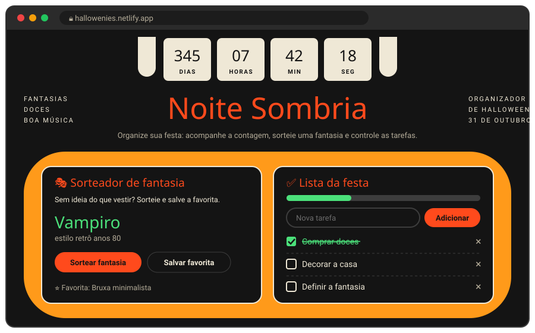
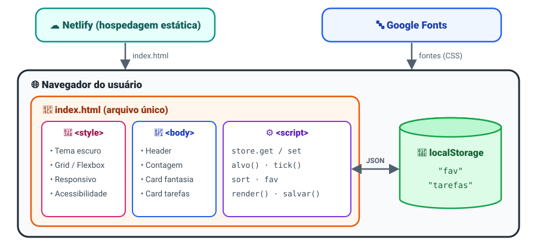
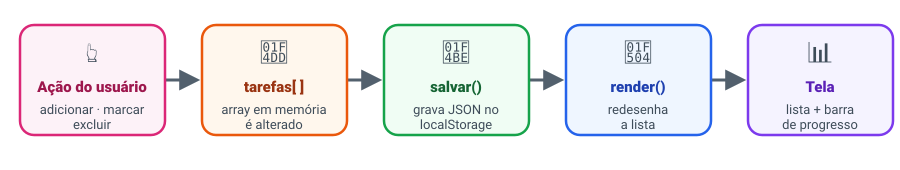

<p align="center">
  
</p>

<p align="center">
  
  
  
  
  
</p>

# 🎃 Noite Sombria: Organizador de Halloween 🦇

Aplicação web de página única 👻 para organizar uma festa de Halloween: ⏳ contagem regressiva até 31 de outubro, 🎭 sorteador de fantasias e ✅ lista de tarefas com barra de progresso.

🔗 **Demo online:** https://hallowenies.netlify.app/

<p align="center">
  
  <br><sub>🖼️ Ilustração da interface da aplicação</sub>
</p>

---

## 🗺️ Sumário

| | | |
|---|---|---|
| 🎯 1. Objetivo | 🤔 2. Problema | 📐 3. Escopo |
| 📋 4. Requisitos | 🧰 5. Tecnologias | 🏛️ 6. Arquitetura |
| 🗂️ 7. Estrutura | ✅ 8. Pré-requisitos | ⚙️ 9. Instalação e execução |
| 🔐 10. Configuração | 💾 11. Armazenamento | 🧪 12. Testes |
| 🚀 13. Deploy | 🤝 14. Contribuição | 🐛 15. Problemas conhecidos |

---

## 🎯 1. Objetivo

Oferecer uma ferramenta simples ✨, rápida ⚡ e sem cadastro 🙅 para quem está organizando uma festa de Halloween. Com ela é possível acompanhar quanto tempo falta para o evento ⏳, decidir uma fantasia 🎭 e controlar as tarefas da preparação ✅.

## 🤔 2. Problema

Organizar uma festa temática costuma envolver anotações espalhadas 📝 (papel, bloco de notas, mensagens 💬), indecisão na escolha da fantasia 🤷 e pouca noção do prazo ⌛. O **Noite Sombria** reúne essas três necessidades em uma única página 📄, que funciona no celular 📱 e no computador 💻 e guarda os dados no próprio navegador 💾.

## 📐 3. Escopo

**✅ Dentro do escopo**
- ⏳ Contagem regressiva até 31 de outubro;
- 🎭 Sorteio aleatório de fantasia (personagem + estilo) e salvamento de uma favorita ⭐;
- 📝 Lista de tarefas: adicionar ➕, marcar como concluída ☑️, excluir 🗑️ e acompanhar o progresso 📊;
- 💾 Persistência local dos dados (`localStorage`);
- 📱 Layout responsivo com tema escuro 🌑.

**❌ Fora do escopo**
- 🔑 Login, contas de usuário ou sincronização entre dispositivos;
- 🗄️ Backend, banco de dados ou API externa;
- 👥 Compartilhamento da lista com outras pessoas;
- 💌 Convites, lista de convidados ou pagamentos 💳.

## 📋 4. Requisitos

### ⚙️ 4.1 Requisitos funcionais

| ID | Requisito |
|---|---|
| ⏳ RF01 | Exibir uma contagem regressiva (dias, horas, minutos e segundos) até 31/10, atualizada a cada segundo. |
| 🎉 RF02 | Em 31/10, trocar a contagem pela mensagem "Hoje! Feliz Halloween". |
| 📅 RF03 | Depois de 31/10, passar a contar até o Halloween do ano seguinte. |
| 🎲 RF04 | Sortear uma fantasia combinando um personagem aleatório (10 opções) com um estilo aleatório (8 opções). |
| ⭐ RF05 | Salvar a fantasia sorteada como favorita e exibi-la mesmo após recarregar a página. |
| ⚠️ RF06 | Mostrar um aviso se o usuário tentar salvar uma favorita sem ter sorteado antes. |
| ➕ RF07 | Adicionar tarefas à lista (texto de até 80 caracteres; texto vazio é ignorado). |
| ☑️ RF08 | Marcar e desmarcar tarefas como concluídas. |
| 🗑️ RF09 | Excluir tarefas. |
| 📊 RF10 | Exibir uma barra de progresso com a porcentagem de tarefas concluídas. |
| 📭 RF11 | Exibir uma mensagem quando a lista estiver vazia. |
| 📝 RF12 | Carregar uma lista inicial padrão no primeiro acesso ("Comprar doces" 🍬, "Decorar a casa" 🏚️, "Definir a fantasia" 🧛). |

### 🛡️ 4.2 Requisitos não funcionais

| ID | Requisito |
|---|---|
| 🌐 RNF01 | **Portabilidade:** funciona em qualquer navegador moderno, sem instalação. |
| 📱 RNF02 | **Responsividade:** layout adaptado a telas a partir de 320 px, com ajustes abaixo de 640 px e suporte a *safe areas* (notch). |
| ⚡ RNF03 | **Desempenho:** um único arquivo HTML, sem dependências JavaScript e sem etapa de build. |
| 💾 RNF04 | **Persistência:** os dados ficam no `localStorage` do navegador; se ele estiver indisponível, a aplicação continua funcionando sem salvar. |
| ♿ RNF05 | **Acessibilidade:** `aria-live` no resultado do sorteio, `aria-label` em campos e botões, foco visível (`:focus-visible`) e respeito a `prefers-reduced-motion`. |
| 🕵️ RNF06 | **Privacidade:** nenhum dado do usuário é enviado a servidores. |
| 🔐 RNF07 | **Segurança:** os textos das tarefas são inseridos com `textContent`, o que evita injeção de HTML (XSS). |

## 🧰 5. Tecnologias

| Tecnologia | 🔧 Uso |
|---|---|
| 🧱 HTML5 | Estrutura da página (`lang="pt-BR"`) |
| 🎨 CSS3 | Estilo com variáveis CSS, Grid, Flexbox, `clamp()` e media queries |
| ⚙️ JavaScript (ES6+, sem framework) | Lógica da contagem, do sorteio e das tarefas |
| 💾 Web Storage API (`localStorage`) | Persistência dos dados no navegador |
| 🔤 Google Fonts | Fontes *Rubik Wet Paint*, *Bagel Fat One* e *Archivo* |
| 👻 SVG inline | Fantasmas decorativos e textura de ruído do fundo |
| ☁️ Netlify | Hospedagem estática e deploy |

📦 Não há gerenciador de pacotes, bundler nem dependências npm.

## 🏛️ 6. Arquitetura

Aplicação **estática, 100% client-side** 🌐, sem backend:

<p align="center">
  
</p>

### 🧩 Componentes principais

| Componente | 🔩 Elementos / funções | 🎯 Responsabilidade |
|---|---|---|
| 🔎 **Helper `$`** | `$(id)` | Atalho para `document.getElementById`. |
| 💾 **`store`** | `get(k, padrão)`, `set(k, valor)` | Ler e gravar JSON no `localStorage`, com `try/catch` para modo privado ou armazenamento bloqueado. |
| ⏳ **Contagem regressiva** | `alvo()`, `tick()`, `#count` | Calcular a próxima data de 31/10 e renderizar dias, horas, minutos e segundos a cada 1 s (`setInterval`). |
| 🎭 **Sorteador de fantasia** | `per[]`, `est[]`, `#sort`, `#fav`, `#fant`, `#favtxt` | Combinar personagem + estilo e salvar a favorita. |
| ✅ **Lista da festa** | `tarefas[]`, `render()`, `salvar()`, `#f`, `#lista`, `#bar`, `#vazio` | CRUD das tarefas, barra de progresso e estado vazio. |

### 🔄 Fluxo das tarefas

<p align="center">
  
</p>

👆 Ação do usuário → 📝 altera o array `tarefas` → 💾 `salvar()` grava no `localStorage` → 🔄 `render()` redesenha a lista e a barra de progresso 📊.

## 🗂️ 7. Estrutura do projeto

```
📁 noite-sombria/
├── 📄 index.html    # 🧱 HTML + 🎨 CSS (<style>) + ⚙️ JS (<script>)
├── 📂 img/          # 🖼️ ilustrações usadas neste README
└── 📘 README.md     # 📚 esta documentação
```

> 💡 Como o projeto é pequeno, tudo fica em um único arquivo. Se ele crescer, a sugestão é separar em `css/style.css` e `js/app.js`.

## ✅ 8. Pré-requisitos

| Item | 🔢 Versão | Obrigatório? |
|---|---|---|
| 🌐 Navegador moderno (Chrome, Edge, Firefox, Safari) | Versões atuais | ✅ Sim |
| 🌿 Git | 2.x ou superior | 📥 Só para clonar |
| 🖥️ Servidor HTTP local (VS Code *Live Server*, Python 3 🐍 ou Node.js 🟢) | Qualquer versão | ➖ Opcional |
| 📶 Conexão com a internet | — | ➖ Opcional (só para carregar as fontes do Google; sem ela, são usadas fontes de fallback) |

## ⚙️ 9. Instalação e execução

```bash
# 1️⃣ Clonar o repositório
git clone https://github.com/<seu-usuario>/<nome-do-repositorio>.git

# 2️⃣ Acessar a pasta
cd <nome-do-repositorio>

# 3️⃣ Instalar dependências
#    → não há dependências a instalar 🎉

# 4️⃣ Executar (escolha uma opção)
#    a) Abrir o arquivo diretamente no navegador (duplo clique em index.html)
#    b) 🐍 Python 3:
python -m http.server 8000
#    c) 🟢 Node.js:
npx serve .
```

🌐 **5️⃣ Acessar a aplicação:** http://localhost:8000 (Python) ou o endereço mostrado pelo `serve`.

### 🩺 Como validar o ambiente
- ⏳ A contagem regressiva deve atualizar a cada segundo;
- 🎲 "Sortear fantasia" deve mostrar um personagem com o estilo logo abaixo;
- 🔄 Depois de adicionar uma tarefa e recarregar a página (F5), ela deve continuar na lista.

### 🧯 Erros comuns
| 😵 Sintoma | 🔍 Causa provável | 🛠️ Solução |
|---|---|---|
| 💨 Tarefas somem ao recarregar | Navegação anônima ou `localStorage` bloqueado | Use uma janela normal ou libere o armazenamento do site |
| 🔤 Fontes diferentes do design | Sem internet ou Google Fonts bloqueado | Verifique a conexão; o layout continua funcional |
| 🕐 Contagem com horário "errado" | O cálculo usa o fuso horário do dispositivo | Confira data e hora do sistema |

## 🔐 10. Configuração e variáveis de ambiente

🚫 O projeto **não usa variáveis de ambiente**, arquivos `.env` nem chaves de API.

🎛️ As opções configuráveis ficam diretamente no `<script>` do `index.html`:

| 📍 Onde | ✏️ O que alterar |
|---|---|
| `const per = [...]` | 🧛 Lista de personagens do sorteio |
| `const est = [...]` | 🎨 Lista de estilos do sorteio |
| `store.get('tarefas', [...])` | 📝 Tarefas padrão do primeiro acesso |
| `alvo()` → `new Date(ano, 9, 31)` | 📅 Data-alvo (o mês começa em 0, então `9` = outubro) |
| `:root { --bg, --blood, --pump, --grn ... }` | 🎨 Paleta de cores do tema |

## 💾 11. Armazenamento de dados

🗄️ Não há banco de dados. Os dados ficam no `localStorage` do navegador, em formato JSON:

| 🔑 Chave | 🏷️ Tipo | 📄 Exemplo |
|---|---|---|
| `fav` | `string` | `"Vampiro retrô anos 80"` |
| `tarefas` | `Array<{ t: string, d: boolean }>` | `[{"t":"Comprar doces","d":false}]` |

`t` = texto da tarefa · `d` = concluída (*done*).

🧹 **Para limpar os dados:** DevTools (F12) → *Application* → *Local Storage* → apagar as chaves, ou executar `localStorage.clear()` no console.

## 🧪 12. Testes

🚧 Ainda não há testes automatizados. Use o roteiro manual abaixo:

| # | 👣 Passo | 🎯 Resultado esperado |
|---|---|---|
| T01 | 🌐 Abrir a página | Contagem visível e atualizando a cada segundo |
| T02 | ⭐ Clicar em "Salvar favorita" sem sortear | Mensagem "Sorteie uma fantasia antes de salvar." |
| T03 | 🎲 Clicar em "Sortear fantasia" | Personagem + "estilo …" exibidos |
| T04 | 🔄 Clicar em "Salvar favorita" e recarregar | "Favorita: …" continua aparecendo |
| T05 | ⬜ Adicionar uma tarefa vazia ou só com espaços | Nada é adicionado |
| T06 | ➕ Adicionar "Comprar abóbora" 🎃 | Item aparece no fim da lista |
| T07 | ☑️ Marcar uma das 4 tarefas | Item riscado e verde; barra em 25% |
| T08 | 🗑️ Excluir todas as tarefas | Mensagem "Nenhuma tarefa. Adicione a primeira acima." |
| T09 | 🔄 Recarregar a página | O estado da lista é mantido |
| T10 | 📅 Simular a data 31/10 (alterando o relógio do sistema) | Exibe "Hoje! Feliz Halloween" 🎉 |
| T11 | 📱 Abrir em tela de até 640 px | Layout em coluna única, sem rolagem horizontal |
| T12 | ⌨️ Navegar só com o teclado (Tab/Enter/Espaço) | Todos os controles acessíveis, com contorno de foco verde |

## 🚀 13. Deploy

☁️ O site está hospedado no **Netlify** como site estático.

**🔁 Opção 1: deploy contínuo via GitHub**
1. No Netlify: *Add new site* → *Import an existing project* → selecione o repositório 🐙;
2. 🏗️ *Build command*: deixe em branco · 📂 *Publish directory*: `.` (raiz);
3. Clique em *Deploy* 🚀. Cada `push` na branch `main` gera um novo deploy.

**🖱️ Opção 2: deploy manual**
Arraste a pasta do projeto para https://app.netlify.com/drop.

**⌨️ Opção 3: Netlify CLI**
```bash
npm install -g netlify-cli
netlify deploy --prod --dir .
```

## 🤝 14. Como contribuir

1. 🍴 Faça um *fork* e crie uma branch: `git checkout -b feature/nome-da-melhoria`;
2. 📝 Faça commits pequenos e descritivos (ex.: `feat: adiciona aba de músicas`, `fix: corrige cor do botão favorita`);
3. 🧪 Execute o roteiro de testes manuais da seção 12;
4. 🔀 Abra um **Pull Request** descrevendo a mudança e anexando prints 📸, se houver alteração visual.

> ⚠️ Nunca commite senhas 🔑, tokens 🎟️ ou arquivos `.env` 📁.

## 🐛 15. Problemas conhecidos e próximos passos

- 🎨 O botão "Salvar favorita" usa a variável CSS `--panel`, que não está definida em `:root`; por isso o fundo cai no valor padrão.
- 🗂️ O CSS já prevê abas (`nav`, `section.tab`) e o cabeçalho cita "Fantasias, Doces, Boa música, Tarefas", mas só a seção principal (`#app`) foi implementada.
- 💡 **Ideias:** 🍬 abas de receitas de doces e 🎵 de playlist, ✏️ edição de tarefas, 📤 exportar a lista e 🤖 testes automatizados (ex.: Playwright).

---

<p align="center">👻 Feito com 🧡 para uma noite bem sombria 🎃🦇🕸️</p>
