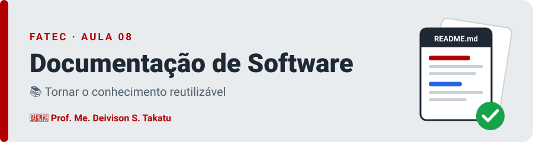
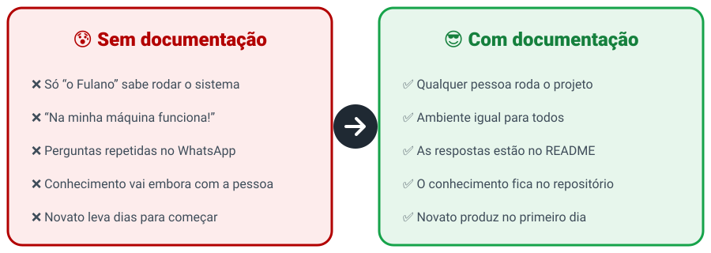
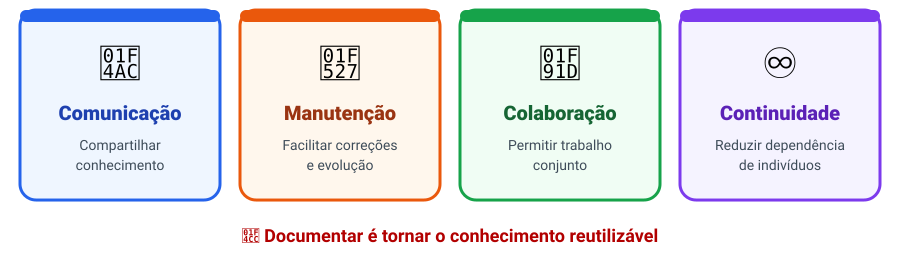
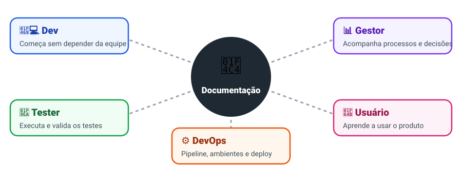
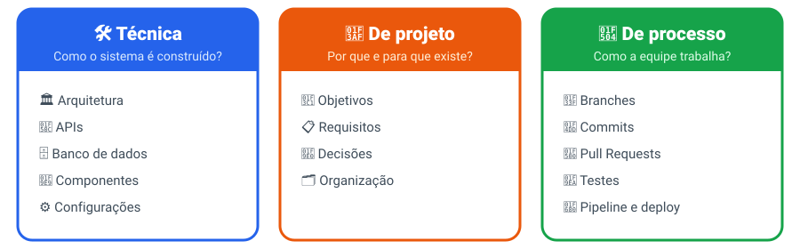
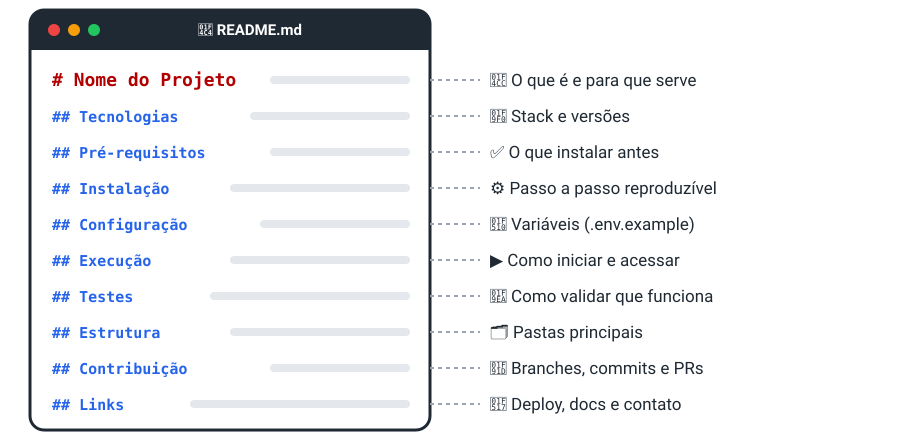
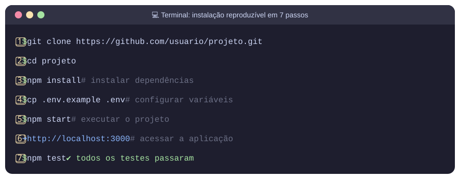
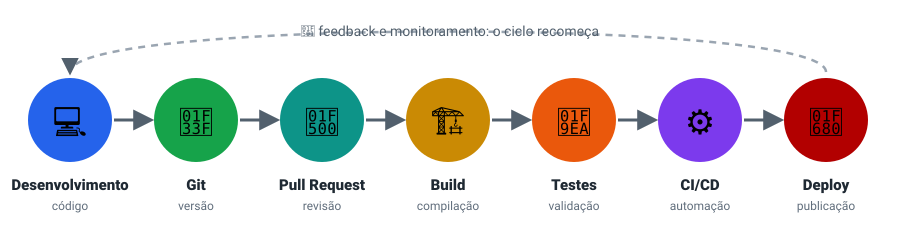
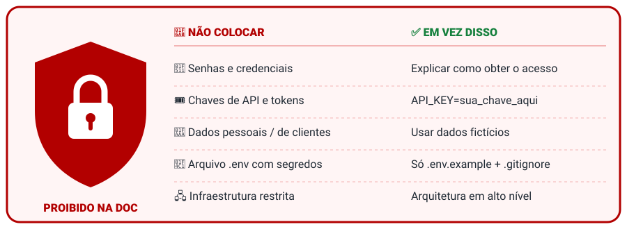

<p align="center">
  
</p>

# 📝 Resumo: Aula 08, Documentação de Software

> 🏫 Fatec · 👨‍🏫 Prof. Me. Deivison S. Takatu

## 🎯 1. A pergunta central

> ❓ *"Se eu entrar hoje no GitHub do seu projeto, consigo entender e executar o projeto sem perguntar nada para vocês?"*

📌 A documentação deve **reduzir a dependência de explicações informais** e permitir que outra pessoa compreenda o projeto sozinha.
🔗 Exemplo da aula: `github.com/deivisontakatu/aula-documentacao-software`.

## 🚨 2. O que acontece sem documentação

<p align="center">
  
</p>

- 👤 Dependência de desenvolvedores específicos;
- 🐣 Dificuldade para novos integrantes entrarem no projeto;
- 🔧 Configurações esquecidas ou executadas de forma diferente;
- 🐢 Mais tempo para manutenção e resolução de problemas;
- 🧳 Conhecimento perdido quando alguém sai da equipe;
- 🔁 Perguntas repetitivas sobre instalação, execução e deploy.

## 📖 3. Definição

📘 **Documentação de software** é o conjunto de informações que ajuda pessoas a **compreender, utilizar, desenvolver, testar e manter** um sistema.

Uma boa documentação responde:

1. ❓ O que é o projeto?
2. 🎯 Para que ele serve?
3. ⚙️ Como instalar e configurar?
4. ▶️ Como executar e testar?
5. 🤝 Como contribuir e fazer mudanças?

## 💡 4. Por que documentar

<p align="center">
  
</p>

| Necessidade | 🎯 Objetivo |
|---|---|
| 💬 **Comunicação** | Compartilhar conhecimento entre pessoas |
| 🔧 **Manutenção** | Facilitar correções e evolução |
| 🤝 **Colaboração** | Permitir trabalho conjunto |
| ♾️ **Continuidade** | Reduzir a dependência de indivíduos |

> 📌 Documentar não é apenas registrar: é **tornar o conhecimento reutilizável** ♻️.

🌟 **Projetos bem documentados para consulta:** 🐧 `torvalds/linux`, ⚛️ `react/react`, 🟢 `nodejs/node`, 🐳 `docker/docs`, ₿ `bitcoin/bitcoin`, 🇧🇷 `github/brasil`.

## 👥 5. Quem usa a documentação

<p align="center">
  
</p>

- 👩‍💻 **Dev**: começa a trabalhar dependendo menos da equipe;
- 🧪 **Tester**: descobre como executar e validar os testes;
- ⚙️ **DevOps**: configura pipeline, ambientes e deploy;
- 📊 **Gestor**: acompanha processos e decisões;
- 🙋 **Usuário**: aprende a usar o produto.

## 🧩 6. Combinação de áreas

| Área | 📝 O que documenta |
|---|---|
| 🏗️ Engenharia de Software | Requisitos, arquitetura, código e testes |
| 📅 Gestão de Projetos | Escopo, cronograma, riscos e entregas |
| ⚙️ DevOps | CI/CD, infraestrutura, deploy e monitoramento |
| 🔐 Segurança da Informação | Vulnerabilidades, políticas, acessos e incidentes |
| ✅ Qualidade (QA) | Testes, critérios de aceitação, evidências |
| 🎨 Produto / UX | Requisitos do usuário, jornadas, regras de negócio, usabilidade |

## 🗃️ 7. Tipos de documentação

<p align="center">
  
</p>

- 🛠️ **Técnica**: arquitetura, APIs, banco de dados, componentes e configurações.
- 🎯 **De projeto**: objetivos, requisitos, decisões e organização.
- 🔄 **De processo**: branches, commits, Pull Requests, testes, pipeline e deploy.

## 📄 8. README

O README costuma ser **o primeiro documento consultado** 👀 em um repositório. Ele deve mostrar rapidamente o propósito, as tecnologias, os pré-requisitos, a instalação e execução, os testes, como contribuir e os links importantes.

<p align="center">
  
</p>

### 🧰 8.1 Tecnologias e pré-requisitos
Informe a stack necessária: linguagem e versão, framework, banco de dados 🗄️, gerenciador de pacotes 📦, Docker 🐳 (quando usado), Git 🌿 etc. Indique **versões mínimas ou recomendadas** 🔢 quando isso fizer diferença.

### ⚙️ 8.2 Instalação e execução
Transforme o processo em uma **sequência reproduzível** 🔁:

1. 📥 Clonar o repositório
2. 📂 Acessar a pasta
3. 📦 Instalar dependências
4. 🔐 Configurar variáveis
5. ▶️ Executar o projeto
6. 🌐 Acessar a aplicação
7. 🧪 Executar os testes

<p align="center">
  
</p>

### 🔐 8.3 Configuração e variáveis
Explique quais variáveis existem, para que servem, quais são obrigatórias e como criar o arquivo de configuração, **sem expor dados sensíveis** 🙈:

```env
PORT=3000
DATABASE_URL=sua_url_aqui
API_KEY=sua_chave_aqui
```

### 🧪 8.4 Execução e testes
Inclua comandos para ▶️ iniciar a aplicação, 🧪 rodar os testes unitários, 🔗 de integração e ⚡ de performance (quando houver) e 📊 verificar resultados e falhas.

### 🗂️ 8.5 Estrutura do projeto
Mostre as pastas principais (ex.: 💻 `src/`, 🧪 `tests/`, 📚 `docs/`, ⚙️ `.github/workflows/`) e a responsabilidade de cada uma. ⚠️ **Não documente arquivo por arquivo** se isso não ajudar o leitor.

## 🔄 9. Documentação do processo DevOps

<p align="center">
  
</p>

| Etapa | 📖 Descrição |
|---|---|
| 💻 Desenvolvimento | Implementação de funcionalidades e correções |
| 🌿 Git | Controle de versão e histórico |
| 🔀 Pull Request | Pedido de revisão e integração das mudanças |
| 🏗️ Build | Compilação ou preparação para execução |
| 🧪 Testes | Validação do funcionamento e busca de falhas |
| ⚙️ Pipeline CI/CD | Automação de integração, validação e entrega |
| 🚀 Deploy | Publicação da aplicação em um ambiente |

🧰 **Tecnologias utilizadas:** registre a *stack*, as *versões e ferramentas* 🔢 (para compatibilidade e reprodução do ambiente) e os *pré-requisitos* ✅ (runtimes, gerenciadores de pacotes, banco, Git, Docker).

⚙️ **Instalação e execução:** dependências e configuração inicial 📦, como iniciar a aplicação ▶️ e como validar o ambiente 🩺 (erros comuns e como confirmar que está funcionando).

## 🚫 10. O que NÃO colocar na documentação

<p align="center">
  
</p>

- 🔑 **Senhas e credenciais** de usuários, administradores ou bancos;
- 🎟️ **Chaves de API e tokens**;
- 🪪 **Dados sensíveis** (informações pessoais, dados de clientes, informações internas);
- 📁 **Arquivos `.env`** ou configurações com segredos;
- 🖧 **Detalhes de infraestrutura restrita** que facilitem acessos indevidos.

## ✍️ 11. Atividade

1. 🎯 Escolher um projeto e documentar **objetivo, problema, escopo e requisitos funcionais e não funcionais**.
2. 🏛️ Descrever as **tecnologias, a arquitetura e a organização dos componentes**.
3. 📄 Criar ou atualizar o **README.md** no GitHub 🐙 com pré-requisitos, instalação, configuração e execução.
4. 🔌 Quando aplicável, documentar **APIs, banco de dados, variáveis de ambiente, testes e deploy**.

➡️ 🎃 Projeto escolhido: **Noite Sombria** (https://hallowenies.netlify.app/). A documentação está em [readme.md](readme.md).

