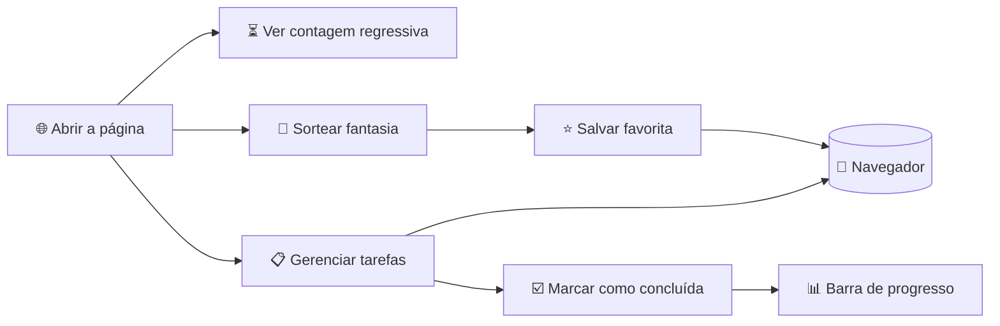

# 🎃 Noite Sombria – Documentação do Software

> 🦇 **Organizador web de Halloween:** contagem regressiva, sorteio de fantasia e lista de tarefas da festa, tudo em uma única página.

| 🏷️ Item | 📋 Detalhe |
| --- | --- |
| **Nome do software** | Noite Sombria |
| **Tipo** | Aplicação web de página única (HTML, CSS e JavaScript) |
| **Tema visual** | Preto, creme, vermelho-laranja e verde, inspirado em pôsteres de Halloween 👻 |
| **Funciona offline?** | Sim, depois de carregada (os dados ficam no navegador) |
| **Custo** | Gratuito 🆓 |

---

## 🗺️ Índice

1. [🎯 Objetivo](#1--objetivo)
2. [⚠️ Problema](#2-️-problema)
3. [📦 Escopo](#3--escopo)
4. [⚙️ Requisitos funcionais](#4-️-requisitos-funcionais)
5. [🛡️ Requisitos não funcionais](#5-️-requisitos-não-funcionais)
6. [🧩 Como o sistema funciona](#6--como-o-sistema-funciona)
7. [📖 Glossário](#7--glossário)

---

## 1. 🎯 Objetivo

Oferecer uma ferramenta web **simples e gratuita** que ajude pessoas a planejar e aproveitar o Halloween (**31 de outubro** 🗓️), reunindo em um só lugar:

- ⏳ a **contagem regressiva** até a data;
- 🧛 a **escolha da fantasia**;
- ✅ a **organização das tarefas** da festa.

### 🎯 Objetivos específicos

| 🏁 Objetivo | 💡 O que significa na prática |
| --- | --- |
| Reduzir o tempo gasto decidindo a fantasia | Um clique entrega uma ideia pronta, como "Bruxa retrô anos 80" |
| Permitir acompanhar o progresso dos preparativos | Uma barra mostra quanto da lista já foi feito |
| Funcionar sem cadastro, instalação ou conexão constante | Basta abrir a página; nada de login, app ou conta |

---

## 2. ⚠️ Problema

Quem organiza uma festa de Halloween costuma **deixar tudo para a última hora** 😱. Isso acontece por três motivos:

1. 📝 **Tarefas espalhadas:** ficam em mensagens, notas e na memória.
2. 🤔 **Indecisão:** escolher a fantasia gera demora e dúvida.
3. ⏰ **Falta de noção de prazo:** ninguém sabe ao certo quanto tempo resta.

> 💥 **Resultado:** estresse, compras apressadas e itens esquecidos.

### 🔧 Como o software resolve

| 😖 Dor do usuário | 🛠️ Solução do software |
| --- | --- |
| Tarefas soltas e esquecidas | Lista única com barra de progresso ✅ |
| Dificuldade de escolher a fantasia | Sorteio de ideias de fantasia 🎲 |
| Sensação de que "ainda dá tempo" | Contagem regressiva sempre visível ⏳ |

---

## 3. 📦 Escopo

O escopo define **o que o sistema faz** e, igualmente importante, **o que ele não faz**.

### ✅ Dentro do escopo

- ⏳ Contagem regressiva até 31/10, com dias, horas, minutos e segundos.
- 🎲 Sorteio de fantasias por combinação de personagem e estilo.
- 📋 Lista de tarefas com marcação, exclusão e progresso.
- 💾 Salvamento local dos dados no navegador do usuário.
- 📱 Interface responsiva (celular, tablet e computador), no tema escuro inspirado em pôsteres de Halloween.

### 🚫 Fora do escopo

- 🔐 Contas de usuário e login.
- 🔄 Sincronização entre dispositivos.
- 🛒 Compra de produtos ou integração com lojas.
- 💌 Convites, confirmação de presença e chat entre convidados.
- 📲 Aplicativo nativo para Android ou iOS.

### 👥 Público e premissas

| 🔖 Tema | 📌 Descrição |
| --- | --- |
| **Público** | Pessoas de 12 anos ou mais que organizam ou participam de festas temáticas |
| **Premissa** | O usuário possui um navegador moderno |
| **Restrição** | Os dados ficam apenas no aparelho. ⚠️ Limpar o navegador apaga a lista |

---

## 4. ⚙️ Requisitos funcionais

Requisitos funcionais descrevem **o que o sistema deve fazer**.

**Legenda de prioridade:** 🔴 Alta  ·  🟡 Média  ·  🟢 Baixa

| Código | 🧩 Módulo | 📝 Requisito | 💬 Em outras palavras | Prioridade |
| --- | --- | --- | --- | --- |
| **RF01** | ⏳ Contagem | O sistema deve exibir o tempo restante até o próximo 31 de outubro, atualizado a cada segundo. | Os "dentes" do topo contam dias, horas, minutos e segundos | 🔴 Alta |
| **RF02** | 🎲 Fantasia | O sistema deve sortear uma fantasia combinando personagem e estilo a cada clique. | Cada clique em "Sortear fantasia" gera uma ideia nova | 🔴 Alta |
| **RF03** | ⭐ Fantasia | O usuário deve poder salvar uma fantasia favorita e vê-la ao reabrir o sistema. | Guarde a ideia que mais gostou | 🟡 Média |
| **RF04** | ➕ Tarefas | O usuário deve poder adicionar tarefas à lista, com texto de até 80 caracteres. | Digite e clique em "Adicionar" | 🔴 Alta |
| **RF05** | ☑️ Tarefas | O usuário deve poder marcar uma tarefa como concluída ou desfazer a marcação. | Marcou por engano? Desmarque | 🔴 Alta |
| **RF06** | 🗑️ Tarefas | O usuário deve poder excluir tarefas. | O botão × remove o item | 🟡 Média |
| **RF07** | 📊 Progresso | O sistema deve mostrar a porcentagem de tarefas concluídas em uma barra de progresso. | A barra verde enche conforme você conclui | 🟡 Média |
| **RF08** | 💾 Dados | O sistema deve manter tarefas e favorita salvas no navegador entre as visitas. | Fechou e voltou? Tudo continua lá | 🔴 Alta |
| **RF09** | 💬 Mensagens | O sistema deve exibir uma mensagem orientando o usuário quando a lista estiver vazia. | Lista vazia mostra "Adicione a primeira tarefa" | 🟢 Baixa |

---

## 5. 🛡️ Requisitos não funcionais

Requisitos não funcionais descrevem **como o sistema deve ser**: qualidade, desempenho, segurança e conforto de uso.

| Código | 🏷️ Categoria | 📝 Requisito | 🎯 Por que importa |
| --- | --- | --- | --- |
| **RNF01** | 🙂 Usabilidade | Todas as ações devem ser feitas em até dois cliques, com textos claros em português. | Quem está ocupado com a festa não pode perder tempo aprendendo a usar o sistema |
| **RNF02** | ⚡ Desempenho | A página deve carregar em menos de 2 segundos em conexão 4G e responder às ações em menos de 100 ms. | Resposta rápida dá sensação de fluidez |
| **RNF03** | 📱 Responsividade | A interface deve funcionar em telas a partir de 360 px de largura, sem rolagem horizontal da página. | A maioria das pessoas usa o celular |
| **RNF04** | ♿ Acessibilidade | Deve haver foco visível no teclado, contraste adequado, rótulos nos campos e respeito à preferência de movimento reduzido. | Qualquer pessoa deve conseguir usar |
| **RNF05** | 🌐 Compatibilidade | Deve funcionar nas versões recentes de Chrome, Firefox, Safari e Edge. | Cobre os navegadores mais usados |
| **RNF06** | 🔒 Privacidade | Nenhum dado pessoal pode ser enviado a servidores; tudo fica no navegador do usuário. | Suas tarefas são só suas |
| **RNF07** | 🧱 Confiabilidade | Se o armazenamento local estiver indisponível, o sistema deve continuar funcionando durante a sessão. | O sistema não "quebra" em navegadores restritos |
| **RNF08** | 🧹 Manutenibilidade | O código deve ficar em um único arquivo HTML, organizado em estilos, estrutura e scripts separados por seção. | Facilita corrigir e evoluir |

### 📊 Visão geral dos requisitos

| Tipo | Quantidade | 🔴 Alta | 🟡 Média | 🟢 Baixa |
| --- | :---: | :---: | :---: | :---: |
| ⚙️ Funcionais | 9 | 4 | 3 | 1 |
| 🛡️ Não funcionais | 8 | n/a | n/a | n/a |

---

## 6. 🧩 Como o sistema funciona

### 🔁 Fluxo de uso



### 🏗️ Estrutura da tela

```text
┌──────────────────────────────────────────┐
│  🦷  [ 02 ][ 14 ][ 33 ][ 07 ]  🦷        │  ← Contagem regressiva (RF01)
│                                          │
│       Noite  Sombria  (título) 🎃        │
├──────────────────────────────────────────┤
│  ┌───────────────┐  ┌─────────────────┐  │
│  │ 🎲 Sorteador   │  │ 📋 Lista da festa│  │  ← Aplicativo
│  │ de fantasia   │  │ ▓▓▓░░ progresso │  │    (RF02 a RF09)
│  └───────────────┘  └─────────────────┘  │
└──────────────────────────────────────────┘
```

### 🔐 Onde ficam os dados?

| 📦 Dado | 📍 Local | ⏱️ Duração |
| --- | --- | --- |
| Tarefas | Armazenamento local do navegador | Até o usuário limpar o navegador |
| Fantasia favorita | Armazenamento local do navegador | Até o usuário limpar o navegador |
| Contagem regressiva | Calculada na hora, não é guardada | Sempre atual |

---

## 7. 📖 Glossário

| 🔤 Termo | 💬 Significado |
| --- | --- |
| **Escopo** | Lista do que o sistema faz e do que não faz |
| **Requisito funcional (RF)** | Algo que o sistema deve *fazer* |
| **Requisito não funcional (RNF)** | Uma qualidade que o sistema deve *ter* (rapidez, segurança, acessibilidade) |
| **Responsivo** | Que se adapta a telas de qualquer tamanho |
| **Armazenamento local** | Espaço no próprio navegador onde o site guarda informações |
| **Contraste** | Diferença entre cor do texto e do fundo, que garante boa leitura |

---

<p align="center">🎃 👻 🦇 🕸️ 🕯️<br><b>Noite Sombria</b> · Documentação do software · Halloween 31/10</p>
